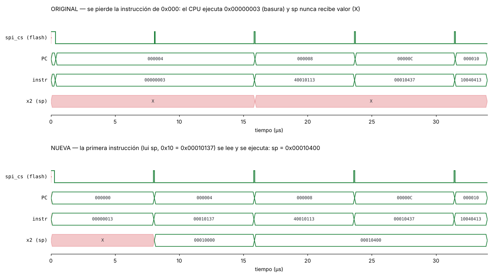
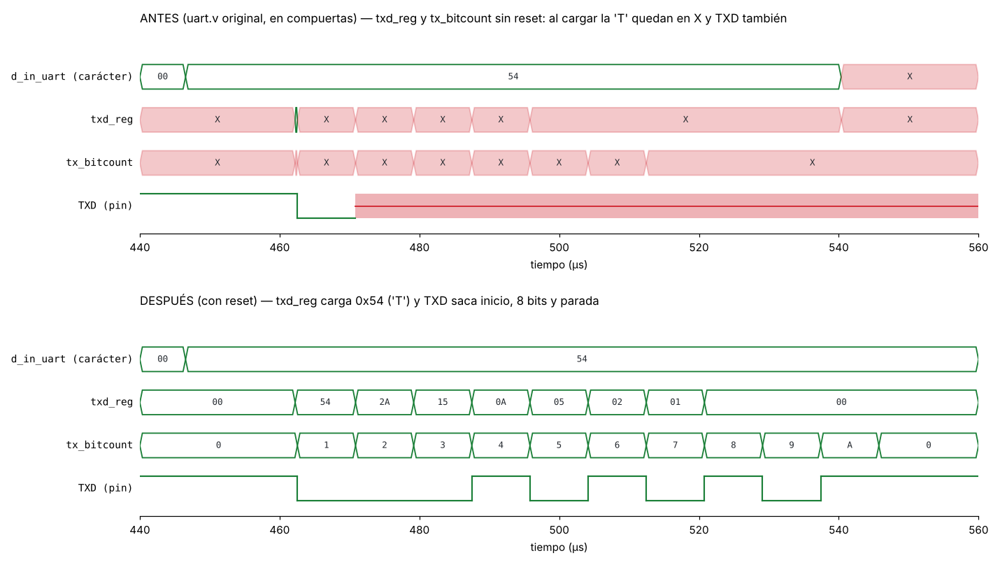
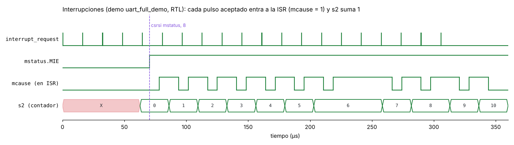

# RISC-V-Cambios — femto_UN v2

Repositorio creado con el fin de arreglar algunos problemas que se tenían con
el primer procesador **femto_UN** y también añadir algunas funciones nuevas.

femto_UN es un SoC RISC-V (CPU FemtoRV32 *quark* + UART + flash SPI + RAM SPI)
del curso de VLSI de la Universidad Nacional de Colombia, sede Manizales,
fabricado en Tiny Tapeout. Este repositorio parte de esa versión y la mejora:
lo que estaba bien se deja igual, lo que estaba mal se corrige.

- `v1_original/` — el código original, sin tocar, como referencia.
- `v2/` — la versión nueva.

En cada cambio de abajo se muestra **el código original**, **el código nuevo**
y **qué se ve en GTKWave** como resultado.

---

## Resumen

| # | Bloque | Problema en el original | Resultado en la v2 |
|---|---|---|---|
| 1 | Flash | Se perdía la primera instrucción de todo programa | Se ejecuta desde la dirección 0 |
| 2 | RAM | Tramas SPI corridas un bit, sin WREN, solo palabras de 32 bits, bytes al revés | Accesos de 8, 16 y 32 bits correctos |
| 3 | UART | Registros sin reset: en compuertas TXD queda en X | TXD transmite bien también en compuertas |
| 4 | Interrupciones | CPU con interrupciones del profesor, sin verificar | Verificadas en simulación |
| 5 | Otros | Código que Icarus 12 no compila, programa de prueba corrupto | Compila y corre en Fedora 44 |

Prueba de la RAM (`test_ram_bytes`, 13 verificaciones de lectura y escritura):

| | Original | v2 |
|---|---|---|
| Simulación RTL | Falla en la primera prueba | **13/13 OK** |
| Simulación con compuertas sky130 | — | **13/13 OK**, mismos tiempos que el RTL |

---

## Cómo correrlo

Requisitos en Fedora: `sudo dnf install iverilog gtkwave`. Todo se corre
desde `v2/sim`:

| Comando | Qué muestra | Tiempo |
|---|---|---|
| `make test_flash` | Cambio 1: primera instrucción, flash nueva y original | ~2 s |
| `make test_ram_hex` | Cambio 2: prueba completa de la RAM nueva | <1 min |
| `make test_ram_original` | Cambio 2: la misma prueba con la RAM original | <1 min |
| `make sim` | Cambio 4: demo de interrupciones y UART | <1 min |
| `make tt_um_femto` | Todo en compuertas sky130 (como en clase) | Ctrl+C y `finish` cuando quieras |

Cada comando abre GTKWave con una vista ya preparada. Los VCD se borran con
`make clean`.

---

## 1. Flash: la primera instrucción se perdía

**Archivo:** `MappedSPIFlash.v`

### Se cambió esto del código original

```verilog
always @(negedge clk) begin
    if (!reset) begin
      state    <= START;
```

### Por esto

```verilog
always @(negedge clk) begin
    if (!reset) begin
      state    <= WAIT_STRB;
```

### Por qué

Al soltar el reset, el CPU pide la primera instrucción con un pulso de
`rstrb` de **un solo ciclo**. La flash original salía del reset hacia `START`
y necesitaba un ciclo más para llegar a `WAIT_STRB`, que es donde mira
`rstrb`: el pedido llegaba justo en ese ciclo y se perdía. El CPU no esperaba
(`rbusy` seguía en 0) y tomaba como instrucción lo que hubiera en el bus: un
0, que el CPU interpreta como `0x00000003` = `lb x0, 0(x0)`. Por eso los
programas del curso repiten su primera instrucción (`lui t1, 0x400` dos
veces). Ahora la flash sale del reset directamente a `WAIT_STRB`.

### Resultado en GTKWave (`make test_flash`)

El programa de prueba empieza con `lui sp, 0x10` (`0x00010137`):



| Señal | Original | Nueva |
|---|---|---|
| Trama de la dirección 0 | A los 0,4 µs, pero es la carga `lb x0, 0(x0)`: el dato va a `x0` y se pierde | A los 0,3 µs, y entrega la instrucción al CPU |
| `instr` en PC = 0 | `0x00000003` (basura) | `0x00010137` (`lui sp, 0x10`) a los 8 µs |
| `x2` (`sp`) | Nunca recibe valor: queda en **X** | `0x00010000` y luego `0x00010400` |

Con `sp` en X, la pila no funciona y el programa se cae en la primera llamada
a subrutina.

---

## 2. RAM SPI

**Archivo:** `MappedSPIRAM.v` (reescrito) y su conexión en `femto.v`.
Detalle completo en [`docs/RAM.md`](docs/RAM.md).

### 2.1 El reloj SPI corría siempre y la trama llegaba corrida

#### Se cambió esto del código original

```verilog
always @(negedge clk) begin
    if (!reset) begin
      CLK    <= 0;
    end
    else begin
      if ( (div_counter == divisor/2) | ( div_counter == divisor ) ) begin
        CLK  <= ~CLK;          // SCK alterna siempre, haya o no transferencia
```

#### Por esto

```verilog
wire sck_run = (state == SEND_WREN) | (state == SEND) | (state == RECEIVE);

always @(negedge clk) begin
   if (!reset || !sck_run) begin
      div_counter <= 0;  clk_div <= 0;  clk_div_rise <= 0;  CLK <= 0;
   end else begin
      ...                       // SCK solo corre durante la transferencia
```

#### Por qué

Con SCK corriendo libre, cuando baja `CS_N` el reloj puede estar en
cualquier fase. Según esa fase, el chip lee el primer bit o se lo salta, y en
el segundo caso toda la trama le llega **corrida un bit**: `03` (READ) se
convierte en `06` (WREN), y `02` (WRITE) en `04` (WRDI, deshabilitar
escritura). En la prueba original, **573 de 1208 tramas** llegaron así. Esto
explica por qué en hardware los programas con RAM "funcionaban cuando
querían". Ahora SCK arranca desde cero con cada transferencia y la trama
siempre llega alineada.

#### Resultado en GTKWave


- **Original:** SCK corre aunque `CS_N` esté en alto. La escritura llega bien
  esta vez, pero la lectura de justo después llega como `06 00 02 00`: el chip
  no devuelve nada y el CPU lee `00000000`.
- **Nueva:** SCK quieto fuera de las tramas; la lectura sale `03 00 01 00` y
  devuelve `44332211`.

### 2.2 Faltaba el WREN antes de escribir

#### Se cambió esto del código original

```verilog
if (wr) begin
  CS_N     <= 1'b0;
  cmd_addr <= {8'h02, 8'h00, word_address[15:0], wdata[31:0]};   // WRITE directo
```

#### Por esto

```verilog
if (wr) begin                       // escritura: primero WREN
   CS_N        <= 1'b0;
   shift_out   <= {CMD_WREN, 56'd0};                        // 0x06
   write_frame <= {CMD_WRITE, 8'h00, wr_addr, wr_bytes};    // 0x02 + dirección + datos
   state       <= SEND_WREN;        // luego WREN_GAP (CS_N en alto) y SEND
```

#### Por qué

La FM25V02 borra su permiso de escritura (WEL) al terminar cada escritura.
Sin un WREN (`0x06`) nuevo, ignora la siguiente. Ahora cada escritura son dos
tramas: `06`, una pausa con `CS_N` en alto y luego `02` + dirección + datos.

#### Resultado en GTKWave

En el grupo *bus SPI* de `make test_ram_hex`, cada escritura empieza con un
**pulso corto de `CS_N`** (8 bits, el WREN), y después viene la trama larga.
Las dos escrituras seguidas de ~33,9 ms quedan guardadas, cada una con su
WREN.

### 2.3 Solo escribía palabras de 32 bits

#### Se cambió esto del código original

El módulo no recibía la máscara de bytes del CPU (`mem_wmask`), y la dirección
no se alineaba:

```verilog
// femto.v
.word_address(mem_address[15:0]),
.wdata(mem_wdata[31:0]),
// MappedSPIRAM.v: siempre 4 bytes, en la dirección tal cual
cmd_addr <= {8'h02, 8'h00, word_address[15:0], wdata[31:0]};
```

#### Por esto

```verilog
// femto.v
.address(mem_address[15:0]),
.wmask(mem_wmask),
.wdata(mem_wdata[31:0]),
// MappedSPIRAM.v: 1, 2 o 4 bytes según la máscara, en el byte exacto
case (wmask)
   4'b0001: begin wr_offset = 2'd0; wr_nbytes = 3'd1; end   // sb en A
   4'b0010: begin wr_offset = 2'd1; wr_nbytes = 3'd1; end   // sb en A+1
   4'b0100: begin wr_offset = 2'd2; wr_nbytes = 3'd1; end   // sb en A+2
   4'b1000: begin wr_offset = 2'd3; wr_nbytes = 3'd1; end   // sb en A+3
   4'b0011: begin wr_offset = 2'd0; wr_nbytes = 3'd2; end   // sh en A
   4'b1100: begin wr_offset = 2'd2; wr_nbytes = 3'd2; end   // sh en A+2
   default: begin wr_offset = 2'd0; wr_nbytes = 3'd4; end   // sw
endcase
wire [15:0] base_addr = {address[15:2], 2'b00};              // lecturas: alineada
wire [15:0] wr_addr   = base_addr + {14'd0, wr_offset};      // escrituras: byte exacto
```

#### Por qué

Un `sb` (guardar un carácter, por ejemplo) escribía 4 bytes y dañaba los
vecinos. La FM25V02 escribe byte a byte, así que basta con mandar la
dirección exacta y solo los bytes que pide la máscara.

#### Resultado en GTKWave


`sb 0xAA` en `0x10101` (a los 16 736,7 µs): WREN y luego una trama de solo
**40 bits** (`02 00 01 01 AA`). En el grupo *contenido del chip*, `mem[257]`
pasa de `22` a `AA` a los 16 757,8 µs y los vecinos no cambian. `ram_log.txt`
lo confirma:

```
16736.7  WR  00010101 <- aa00aaaa  mask 0010   ← solo el byte 1
16793.9  RD  00010100 -> 4433aa11              ← el resto de la palabra igual
```

### 2.4 Los bytes quedaban al revés

#### Se cambió esto del código original

```verilog
assign rdata = rcv_data;
```

#### Por esto

```verilog
assign rdata     = {rcv_data[7:0], rcv_data[15:8], rcv_data[23:16], rcv_data[31:24]};
wire [31:0] wdata_seq = {wdata[7:0], wdata[15:8], wdata[23:16], wdata[31:24]};
```

#### Por qué

RISC-V es *little-endian*: el byte de la dirección A es el menos
significativo de la palabra. La flash ya lo hacía así; la RAM no, así que
`lb`/`lbu` leían el byte equivocado.

#### Resultado en GTKWave

Después de `sw 0x44332211` en `0x10100`, el grupo *contenido del chip*
muestra:

| | `mem[256]` | `mem[257]` | `mem[258]` | `mem[259]` |
|---|---|---|---|---|
| Original | `44` | `33` | `22` | `11` |
| Nueva | `11` | `22` | `33` | `44` |

### 2.5 La lectura perdía el último bit

#### Se cambió esto del código original

```verilog
RECEIVE: begin
  if(clk_div) begin
    if(rcv_bitcount <= 1) begin
      state <= START;                      // el último bit no se guarda
    end
    else begin
      rcv_bitcount <= rcv_bitcount - 6'd1;
      rcv_data     <= {rcv_data[30:0],MISO};
```

#### Por esto

```verilog
RECEIVE: begin
   if (clk_div_rise) begin                 // flanco de subida de SCK
      rcv_data <= {rcv_data[30:0], MISO};  // se guarda siempre
      if (rcv_bitcount == 1)
         state <= DONE;
      else
         rcv_bitcount <= rcv_bitcount - 6'd1;
```

#### Por qué

Es el mismo error que ya se había corregido en la flash: muestreaba con
`clk_div` en vez del flanco de subida y salía de `RECEIVE` sin guardar el
último bit. Ahora usa el mismo esquema que la flash, ya probado en hardware.

#### Resultado en GTKWave

En la lectura de 126–154 µs, `rdata` termina en `44332211`: los 32 bits
completos de lo que se escribió.

### Resultado de toda la RAM

| | `make test_ram_original` | `make test_ram_hex` |
|---|---|---|
| Terminal | `T1` y el programa se pierde | `T1 OK` … `T13 OK`, `FIN` |
| Chip, 0x100–0x10B al final | `44 33 22 11 FF FF FF FF FF FF FF FF` | `11 AA EF BE 78 56 34 12 F0 DE BC 9A` |


---

## 3. UART: registros sin reset

**Archivo:** `uart.v`

### Se cambió esto del código original

```verilog
if (reset) begin
    tx_busy     <= 0;
    uart_txd    <= 1;
    tx_count16  <= 0;
end else begin
```

### Por esto

```verilog
if (reset) begin
    tx_busy     <= 0;
    uart_txd    <= 1;
    tx_count16  <= 0;
    tx_bitcount <= 0;
    txd_reg     <= 0;
end else begin
```

(Y `rx_data <= 0` en el reset de la recepción.)

### Por qué

`tx_bitcount` y `txd_reg` arrancaban sin valor. En la simulación RTL y en el
chip no se nota: en RTL un `if` con X toma la rama `else`, y en el chip los
registros arrancan en 0 o 1. Pero en la **simulación con compuertas** el X se
cuela por la lógica sintetizada (*pesimismo de X*) y TXD queda en X desde el
primer carácter. La lógica no cambia: solo se fija el valor inicial.

### Resultado en GTKWave (simulación con compuertas)



- **Antes:** `d_in_uart` tiene la `T` (`0x54`), pero `txd_reg` y `tx_bitcount`
  están en X; TXD saca el bit de inicio a los 462,5 µs y a los 470,9 µs se
  vuelve X (rojo).
- **Después:** `txd_reg` carga `0x54` y se desplaza (`54`, `2A`, `15`, …), y
  TXD saca inicio, `0 0 1 0 1 0 1 0` (la `T`, del bit menos significativo al
  más) y parada.

En la terminal de `make tt_um_femto` aparece `[  3.233 ms] UART: T1 OK`,
igual que en RTL.

---

## 4. Interrupciones

**Archivo:** `femtorv32_quark_un_irq.v` (CPU con interrupciones del profesor).

No se cambió su lógica (solo el orden de las declaraciones, ver el punto 5).
Lo nuevo es que **se verificó en simulación** con la demo del profesor
(`uart_full_demo.S`). La demo configura `mtvec`, activa las interrupciones con
`csrsi mstatus, 8`, y su rutina (`isr`) suma 1 a `s2` y regresa con `mret`.
El testbench manda 20 pulsos por `interrupt_request` (pin `ui_in[3]`).

### Resultado en GTKWave (`make sim`)



- Antes de los 70,5 µs `mstatus.MIE = 0`: los pulsos no se atienden, solo
  quedan anotados como uno pendiente.
- Al activar `MIE`, el CPU entra a la rutina (`mcause = 1`), `s2` sube y
  `mret` regresa al programa. El programa principal sigue imprimiendo
  `Hello World` normalmente.
- Después de activar `MIE` llegan 15 pulsos más (además del que quedó
  pendiente), pero `s2` llega a **10**: si llega un pulso mientras se atiende
  otro, se guarda en una sola bandera pendiente, así que dos o tres pulsos
  seguidos durante la rutina cuentan como uno. Así está diseñado este CPU.

---

## 5. Cambios sin efecto en la lógica

| Archivo | Original | Nuevo | Motivo |
|---|---|---|---|
| `femtorv32_quark_un_irq.v`, `femto.v` | Señales usadas antes de declararse (`instr`, `PC`, `cs`, `dpram_dout`, …) | Declaraciones al inicio del módulo | Icarus Verilog 12 (Fedora 44) no lo compila: 73 errores |
| `femto.v` | Sin pines de alimentación | `inout VPWR, VGND` solo con `USE_POWER_PINS` | Para que la netlist sintetizada se conecte al testbench como la del chip |
| `uart_full_demo.S` | `csrsi mst	sw ra,0(sp) ...` / `atus, 8` (línea partida por un texto pegado) | `csrsi mstatus, 8` | El programa de interrupciones no ensamblaba |

---

## Herramientas de verificación agregadas

| Archivo | Para qué |
|---|---|
| `v2/firmware/asm/test_ram_bytes.S` | Prueba de la RAM con `sw`/`sh`/`sb` y `lw`/`lh`/`lhu`/`lb`/`lbu`; imprime `Tn OK` o `Tn FALLO valor` |
| `v2/sim/tt_um_femto_TB.v` | `+tiempo_ms=N`, `+ram_log` (cada acceso a la RAM en `ram_log.txt`), decodificador del pin TXD para la simulación con compuertas |
| `v2/sim/*.gtkw` | Vistas de GTKWave para la RAM, la flash y las compuertas |
| `v2/synth/synth.ys` | Síntesis de la v2 a celdas sky130 con Yosys (`make synth`) |
| `v2/sim/Makefile` | Todos los `make` de la tabla [Cómo correrlo](#cómo-correrlo) |

La simulación con compuertas (`make tt_um_femto`, Ctrl+C y `finish`) se
explica en [`docs/POSTSINTESIS.md`](docs/POSTSINTESIS.md).

---

## Estado

**Verificado en simulación:**

- RTL: flash, RAM (13/13), UART e interrupciones.
- Compuertas sky130 (post-síntesis): prueba de la RAM 13/13 y `FIN` a los
  47,101 ms, con los mismos tiempos que el RTL.

**Pendiente:**

- Probar en hardware (FPGA Tang Primer 20K o un nuevo chip). El chip
  fabricado tiene la versión original.
- Flujo físico (LibreLane): netlist post-layout y análisis de tiempos.
- Interrupciones en compuertas y con una rutina que guarde registros.

Registro detallado de cada cambio: [`docs/CHANGES.md`](docs/CHANGES.md).

---

## Estructura

```
v1_original/            Código original (no se edita)
  rtl/                    femto_UN/src del repo del curso
  sim/                    testbench, modelos de memoria, netlist del chip (tt_um_femto.v)
  firmware/               programas en ensamblador
v2/                     Versión nueva
  rtl/                    RTL del SoC
  sim/                    testbench, Makefile, vistas de GTKWave, modelos sky130
    hex/                    programas ya ensamblados
  synth/                  síntesis con Yosys y netlist de la v2
  firmware/asm/           programas de prueba
docs/
  RAM.md                  cambios de la RAM en detalle
  POSTSINTESIS.md         simulación con compuertas
  CHANGES.md              registro de todos los cambios
  img/                    imágenes de este README
```

`v1_original/` se tomó del repositorio del curso
[`cicamargoba/VLSI`](https://github.com/cicamargoba/VLSI), commit `42705d7`
(14 de octubre de 2026).
