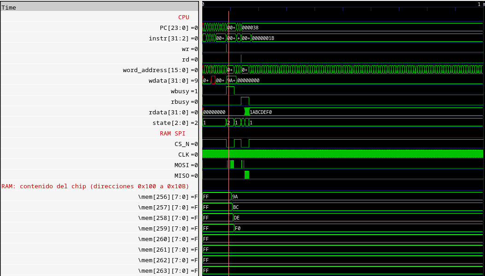
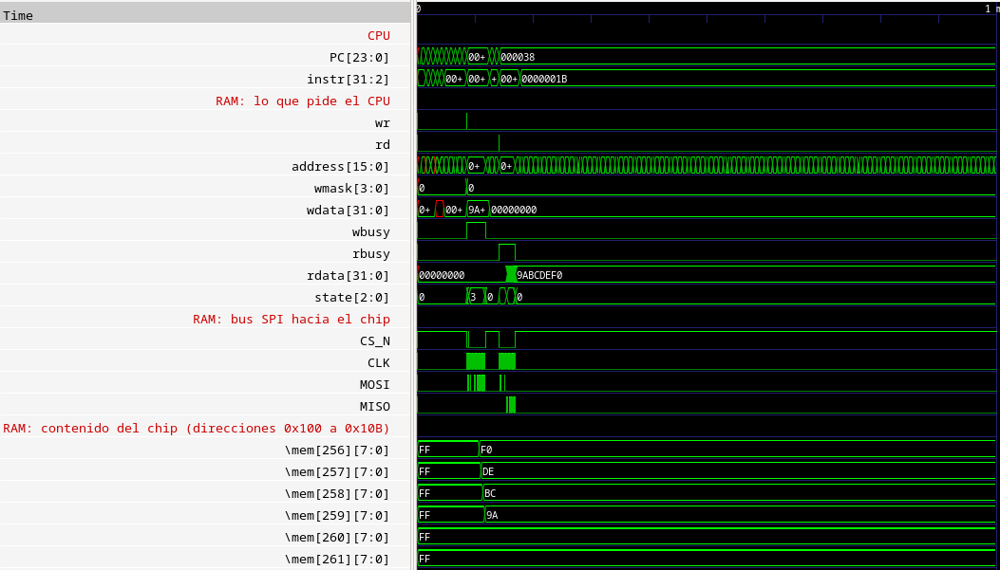

# RISC-V-Cambios — femto_UN v2

Repositorio creado con el fin de arreglar algunos problemas que se tenían con
el primer procesador **femto_UN** y también añadir algunas funciones nuevas.

Por ahora este documento cubre los cambios en la **RAM SPI**: el controlador
`MappedSPIRAM.v`, que conecta el procesador con la memoria FRAM **FM25V02** de
la placa, y su conexión en `femto.v`.

- `v1_original/rtl/MappedSPIRAM.v` — el código original, sin tocar.
- `v2/rtl/MappedSPIRAM.v` — el código nuevo.

---

## Resumen

| # | Problema en la RAM original | Qué pasaba | Estado en la v2 |
|---|---|---|---|
| 1 | **La lectura solo guardaba 31 bits** | Se perdía el bit 31 de cada palabra leída | Corregido: guarda los 32 bits |
| 2 | El reloj SPI corría siempre | Según el momento, la trama llegaba corrida un bit y el chip recibía otro comando | Corregido: SCK solo durante la transferencia |
| 3 | No mandaba WREN antes de escribir | El chip ignora las escrituras después de la primera | Corregido: WREN antes de cada escritura |
| 4 | Solo escribía palabras de 32 bits | `sb` y `sh` dañaban los bytes vecinos | Corregido: escribe 1, 2 o 4 bytes |
| 5 | Bytes al revés | `lb`/`lbu` leían el byte equivocado | Corregido: mismo orden que RISC-V |

Resultado con el programa de prueba `test_ram_bytes` (13 verificaciones de
escritura y lectura):

| | RAM original | RAM nueva |
|---|---|---|
| Terminal | `T1` y el programa se pierde | `T1 OK` … `T13 OK`, `FIN` |
| Contenido final del chip (0x100–0x10B) | `44 33 22 11 FF FF FF FF FF FF FF FF` | `11 AA EF BE 78 56 34 12 F0 DE BC 9A` |

Todo está verificado **en simulación** (Icarus Verilog con el modelo de la
FM25V02). Falta probarlo en hardware.

---

## Cómo verlo

Requisitos en Fedora: `sudo dnf install iverilog gtkwave`. Desde `v2/sim`:

| Comando | Qué hace |
|---|---|
| `make test_31bits` | Escribe `0x9ABCDEF0` y lo lee, con la RAM nueva y con la original (cambio 1) |
| `make test_ram_hex` | Prueba completa de la RAM nueva (`test_ram_bytes`, ~80 ms simulados) |
| `make test_ram_original` | La misma prueba con la RAM original |
| `make clean` | Borra los VCD y registros generados |

Cada comando abre GTKWave con una vista de la RAM organizada en cuatro grupos:

- **lo que pide el CPU:** `wr`, `rd`, dirección, `wmask`, `wdata`, `rbusy`, `wbusy`, `rdata`, `state`;
- **bus SPI hacia el chip:** `CS_N`, `CLK` (SCK), `MOSI`, `MISO`;
- **contenido del chip:** `mem[256]` a `mem[267]`, las direcciones 0x100 a 0x10B;
- **UART.**

Además, cada prueba deja un registro de accesos (`ram_log*.txt`) con cada
lectura y escritura y su tiempo en µs, para ubicar el cursor en GTKWave.

En las dos pruebas solo cambia `MappedSPIRAM.v`: el CPU, el programa y el
modelo del chip son los mismos.

---

## 1. La lectura solo guardaba 31 bits

Es el problema principal. La RAM recibe la palabra bit por bit por MISO (32
bits), pero el original solo guardaba 31.

### Se cambió esto del código original

```verilog
RECEIVE: begin
  if(clk_div) begin
    if(rcv_bitcount <= 1) begin
      state         <= START;             // sale SIN guardar MISO
    end
    else begin
      rcv_bitcount <= rcv_bitcount - 6'd1;
      rcv_data     <= {rcv_data[30:0],MISO};
      state         <= RECEIVE;
    end
  end
end
```

`rcv_bitcount` empieza en 32. Se guarda un bit cuando el contador vale 32, 31,
…, 2, o sea **31 veces**; cuando llega a 1, sale sin guardar.

### Por esto

```verilog
RECEIVE: begin
   if (clk_div_rise) begin                 // en el flanco de subida de SCK
      rcv_data <= {rcv_data[30:0], MISO};  // guarda el bit SIEMPRE
      if (rcv_bitcount == 1)
         state <= DONE;
      else
         rcv_bitcount <= rcv_bitcount - 6'd1;
   end
end
```

Ahora el bit se guarda en cada paso, también en el último (contador en 32,
31, …, 1): **32 veces**. Además, se muestrea en el flanco de subida de SCK
(`clk_div_rise`), que es cuando el dato de MISO es válido en SPI modo 0. Es el
mismo esquema que ya usaba `MappedSPIFlash.v`.

### Qué bit se perdía

Se midió en simulación comparando los 32 bits que el chip pone en MISO con los
que guarda la RAM. Ejemplo de una lectura del original:

```
chip envió (32 bits):  00000000000000000000000101111000
RAM guardó (31 bits):   0000000000000000000000101111000
```

La RAM original empieza a guardar un paso tarde: **pierde el primer bit que
envía el chip, que es el bit 31** (el más significativo). En el bit 31 de
`rdata` queda un bit sobrante de la lectura anterior. Cuando ese bit vale 0,
como en el ejemplo, el valor leído parece correcto; cuando vale 1, no.

### Medición: escribir `0x9ABCDEF0` y leerlo (`make test_31bits`)

El bit 31 de `0x9ABCDEF0` es 1, así que el error se ve:

| | Bits guardados en la lectura | Valor leído |
|---|---|---|
| RAM original | 31 | `0x1ABCDEF0`  (el `9` pasa a `1`: se perdió el bit 31) |
| RAM nueva | 32 | `0x9ABCDEF0` |

En la prueba completa (`test_ram_bytes`), **todas** las lecturas de la RAM
original guardan 31 bits y todas las de la nueva guardan 32.

### En la simulación (GTKWave)

Con `make test_31bits` se abren dos ventanas, una por versión. La lectura
está cerca de los **140–170 µs** (`CS_N` en bajo, después de la escritura).
Para contar los bits, agrega desde el panel *SST*
(`tt_um_femto_TB → uut → femto0 → mapped_spi_ram`) la señal `rcv_bitcount`:

| Señal | RAM original | RAM nueva |
|---|---|---|
| `MISO`, al final de la trama de lectura | El chip envía `9A BC DE F0` | El chip envía `F0 DE BC 9A` (orden de bytes, ver el cambio 5) |
| `rcv_bitcount` | Baja de 32 a 1, pero el último paso no guarda bit | Baja de 32 a 1 guardando un bit en cada paso |
| `rdata`, cuando `rbusy` baja | `1ABCDEF0` | `9ABCDEF0` |

**RAM original:**



- `rdata = 1ABCDEF0`: se perdió el bit 31 (el `9`, `1001`, pasa a `1`, `0001`).
- `CLK` corre todo el tiempo, también con `CS_N` en alto (cambio 2).
- La escritura es un solo bajón de `CS_N`, sin WREN (cambio 3).
- `mem[256..259] = 9A BC DE F0`: bytes al revés (cambio 5).

**RAM nueva:**



- `rdata = 9ABCDEF0`: llegaron los 32 bits.
- `CLK` solo tiene dos ráfagas, la escritura y la lectura, mientras `CS_N` está en bajo.
- La escritura empieza con el pulso corto del WREN y luego la trama larga.
- `mem[256..259] = F0 DE BC 9A`: el byte bajo en la dirección más baja.

Mismo programa, mismo chip; solo cambia `MappedSPIRAM.v`.

Y en la terminal:

```
Se escribió 0x9ABCDEF0 y se leyó:
  RAM nueva:         169.5  RD  00010100 -> 9abcdef0
  RAM original:      166.2  RD  00010100 -> 1abcdef0
```

---

## 2. El reloj SPI corría siempre

### Se cambió esto del código original

```verilog
always @(negedge clk) begin
    if (!reset) begin
      CLK    <= 0;
    end
    else begin
      if ( (div_counter == divisor/2) | ( div_counter == divisor ) ) begin
        CLK  <= ~CLK;                     // alterna siempre, haya o no transferencia
```

### Por esto

```verilog
wire sck_run = (state == SEND_WREN) | (state == SEND) | (state == RECEIVE);

always @(negedge clk) begin
   if (!reset || !sck_run) begin
      div_counter <= 0;  clk_div <= 0;  clk_div_rise <= 0;  CLK <= 0;
   end else begin
      ...                                 // SCK solo corre durante la transferencia
```

### Por qué

Con SCK corriendo libre, cuando baja `CS_N` el reloj puede estar en cualquier
punto de su ciclo. Según ese punto, el chip lee el primer bit o se lo salta.
Si se lo salta, toda la trama le llega **corrida un bit**:

| El controlador envía | El chip recibe |
|---|---|
| `03` (READ) | `06` (WREN): no devuelve nada, el CPU lee `00000000` |
| `02` (WRITE) | `04` (WRDI, deshabilitar escritura): no guarda nada |

En la prueba completa de la RAM original llegaron así **573 de 1208 tramas**.
Como depende del momento exacto de cada acceso, el resultado cambia de un
programa a otro, lo que explica por qué en hardware los programas con RAM
"funcionaban cuando querían". Ahora SCK arranca desde cero con cada trama, así
que siempre llega alineada.

### En la simulación (GTKWave)

En el grupo *bus SPI*:

- **Original** (`make test_ram_original`): `CLK` alterna todo el tiempo, también
  con `CS_N` en alto.
- **Nueva** (`make test_ram_hex`): `CLK` solo se mueve mientras `CS_N` está en
  bajo. En la escritura de los ~86 µs, MOSI lleva `06`, luego `02 00 01 00` y los
  datos.

---

## 3. Faltaba el WREN antes de escribir

### Se cambió esto del código original

```verilog
if (wr) begin
  CS_N         <= 1'b0;
  rbusy        <= 1'b0;
  wbusy        <= 1'b1;
  snd_bitcount <= 8'd64;
  rcv_bitcount <= 6'd0;
  cmd_addr     <= {8'h02, 8'h00, word_address[15:0], wdata[31:0]};   // WRITE directo
  state        <= WAIT_SCLK;
end
```

### Por esto

```verilog
if (wr) begin                       // escritura: primero WREN
   CS_N         <= 1'b0;
   wbusy        <= 1'b1;
   is_write     <= 1'b1;
   shift_out    <= {CMD_WREN, 56'd0};                         // 0x06
   snd_bitcount <= 6'd7;
   write_frame  <= {CMD_WRITE, 8'h00, wr_addr, wr_bytes};     // 0x02 + dirección + datos
   write_bits   <= 6'd31 + {wr_nbytes, 3'b000};  // 32 + 8n - 1
   state        <= SEND_WREN;      // luego WREN_GAP (CS_N en alto) y SEND
end
```

### Por qué

La FM25V02 borra su permiso de escritura (WEL) al terminar cada escritura. Sin
un WREN (`0x06`) nuevo, ignora la siguiente. Ahora cada escritura son dos
tramas: `06`, una pausa corta con `CS_N` en alto y luego `02` + dirección +
datos.

### En la simulación (GTKWave)

En el grupo *bus SPI* de `make test_ram_hex`, cada escritura empieza con un
**pulso corto de `CS_N`** (8 bits de SCK, el WREN) seguido de la trama larga.
Las dos escrituras seguidas de la prueba T11–T12 (~33,9 ms), cada una con su
WREN, quedan guardadas: en *contenido del chip*, `mem[260..263]` pasan a
`78 56 34 12` y `mem[264..267]` a `F0 DE BC 9A`.

---

## 4. Solo escribía palabras de 32 bits

### Se cambió esto del código original

El controlador no recibía la máscara de bytes del CPU (`mem_wmask`), y usaba
la dirección tal cual, sin alinear:

```verilog
// femto.v
.word_address(mem_address[15:0]),
.wdata(mem_wdata[31:0]),

// MappedSPIRAM.v: siempre 4 bytes
cmd_addr     <= {8'h02, 8'h00, word_address[15:0], wdata[31:0]};
```

### Por esto

```verilog
// femto.v
.address(mem_address[15:0]),
.wmask(mem_wmask),
.wdata(mem_wdata[31:0]),

// MappedSPIRAM.v: 1, 2 o 4 bytes según la máscara, en el byte exacto
case (wmask)
   4'b0001: begin wr_offset = 2'd0; wr_nbytes = 3'd1; end   // sb en A
   4'b0010: begin wr_offset = 2'd1; wr_nbytes = 3'd1; end   // sb en A+1
   4'b0100: begin wr_offset = 2'd2; wr_nbytes = 3'd1; end   // sb en A+2
   4'b1000: begin wr_offset = 2'd3; wr_nbytes = 3'd1; end   // sb en A+3
   4'b0011: begin wr_offset = 2'd0; wr_nbytes = 3'd2; end   // sh en A
   4'b1100: begin wr_offset = 2'd2; wr_nbytes = 3'd2; end   // sh en A+2
   default: begin wr_offset = 2'd0; wr_nbytes = 3'd4; end   // sw
endcase

wire [15:0] base_addr = {address[15:2], 2'b00};            // lecturas: dirección alineada
wire [15:0] wr_addr   = base_addr + {14'd0, wr_offset};    // escrituras: byte exacto
```

### Por qué

Un `sb` (guardar un carácter, por ejemplo) escribía 4 bytes y dañaba los tres
vecinos. Como la FM25V02 escribe byte a byte, basta con mandar la dirección
exacta y solo los bytes que indica la máscara: la trama dura 32 + 8·n bits
(comando, 3 bytes de dirección y n bytes de dato).

### En la simulación (GTKWave)

En `make test_ram_hex`, la prueba T6 hace `sb 0xAA` en `0x10101`:

| Grupo | Señal | Qué se ve (~16,74 ms) |
|---|---|---|
| lo que pide el CPU | `wr`, `wmask`, `address` | `wmask = 0010`, `address = 0101` |
| bus SPI | `CS_N`, `MOSI` | WREN y luego una trama de solo **40 bits**: `02 00 01 01 AA` |
| contenido del chip | `mem[257]` | Pasa de `22` a `AA`; `mem[256]`, `mem[258]` y `mem[259]` no cambian |

En `ram_log.txt`:

```
16736.7  WR  00010101 <- aa00aaaa  mask 0010   ← solo se escribe el byte 1
16793.9  RD  00010100 -> 4433aa11              ← el resto de la palabra no cambió
```

(En `aa00aaaa` el CPU repite el byte en todos los carriles; la máscara `0010`
indica que solo vale el carril 1.)

---

## 5. Los bytes quedaban al revés

### Se cambió esto del código original

```verilog
assign rdata = rcv_data;
```

### Por esto

```verilog
assign rdata = {rcv_data[7:0], rcv_data[15:8], rcv_data[23:16], rcv_data[31:24]};

wire [31:0] wdata_seq = {wdata[7:0], wdata[15:8], wdata[23:16], wdata[31:24]};
```

### Por qué

RISC-V es *little-endian*: el byte de la dirección A es el menos significativo
de la palabra. La flash ya lo hacía así; la RAM no. Con `lw`/`sw` el error casi
no se nota, porque se escribe y se lee al revés, pero `lb`/`lbu` leían el byte
equivocado. Ahora la RAM guarda y entrega los bytes en el mismo orden que la
flash.

### En la simulación (GTKWave)

Después de `sw 0x44332211` en `0x10100` (primera prueba), en *contenido del
chip*:

| | `mem[256]` | `mem[257]` | `mem[258]` | `mem[259]` |
|---|---|---|---|---|
| RAM original | `44` | `33` | `22` | `11` |
| RAM nueva | `11` | `22` | `33` | `44` |

Con la RAM nueva, las pruebas T2–T5 (`lbu` de cada byte) leen `11`, `22`,
`33` y `44`, como espera el programa.

---

## Máquina de estados nueva

```
            wr                       fin del WREN        pausa
  IDLE ───────────► SEND_WREN ──────────────────► WREN_GAP ──────► SEND
   │  ▲             (0x06)          CS_N = 1      (CS_N = 1)       (0x02 + dirección + datos)
   │  │                                                              │ escritura
   │  └──────────── DONE ◄───────────────────────────────────────────┘
   │ rd             (CS_N = 1)  ▲
   └──────────────► SEND ───────┴── RECEIVE (32 bits, flanco de subida)
                    (0x03 + dirección)  lectura
```

---

## Estado

- **Verificado en simulación RTL:** los cinco cambios, con `test_ram_bytes`
  (13/13) y `test_ram_31bits`.
- **Verificado en simulación con compuertas sky130** (netlist de Yosys):
  `test_ram_bytes` 13/13, con los mismos tiempos que en RTL.
- **Pendiente:** probar la RAM nueva en hardware (FPGA o un nuevo chip), porque
  el chip fabricado tiene la versión original.

`v1_original/` se tomó del repositorio del curso
[`cicamargoba/VLSI`](https://github.com/cicamargoba/VLSI), commit `42705d7`.
