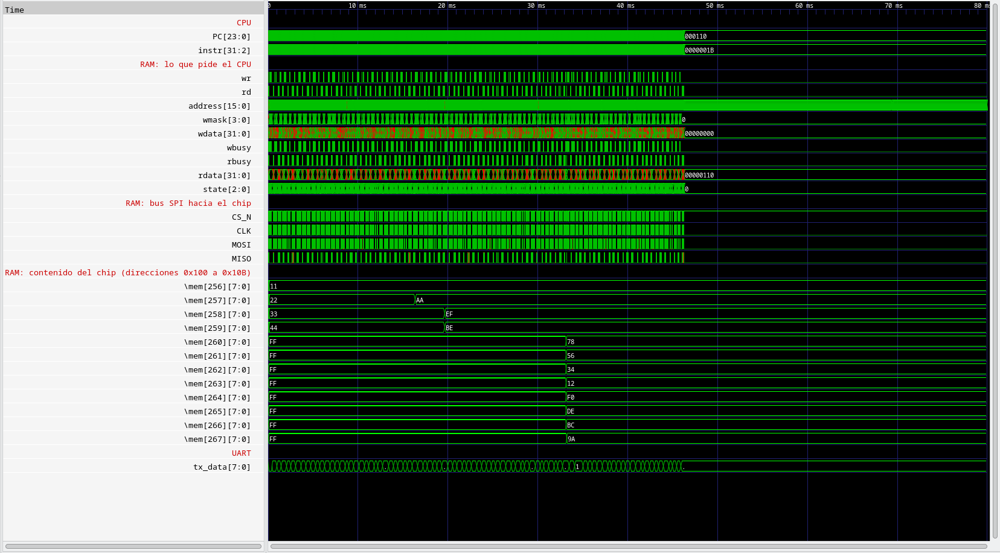
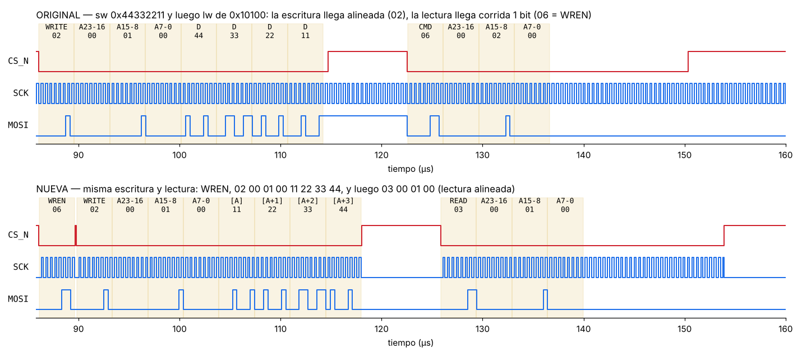
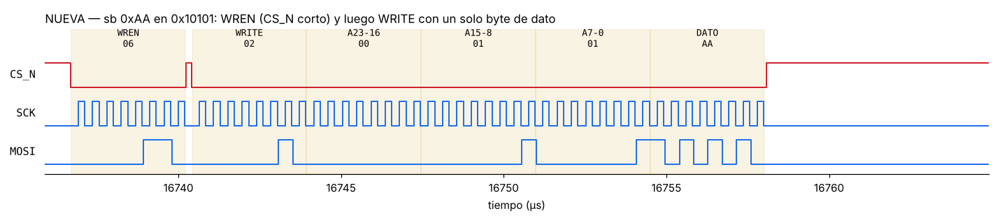

# Cambios en la RAM SPI: original vs. nuevo

Este documento compara el controlador de RAM SPI del femto_UN original
(`v1_original/rtl/MappedSPIRAM.v`) con la versión nueva
(`v2/rtl/MappedSPIRAM.v`). Explica qué fallaba, qué se cambió y cómo se
comprobó en simulación con el modelo de la FRAM **FM25V02**, la misma RAM de la
placa.

## Resumen

| | Original | Nuevo |
|---|---|---|
| Accesos que soporta | Solo palabras de 32 bits, y no siempre | 8, 16 y 32 bits (`sb`/`sh`/`sw`, `lb`/`lbu`/`lh`/`lhu`/`lw`) |
| SCK | Corre siempre, también con `CS_N` en alto | Solo durante la transferencia |
| Alineación de la trama | Depende de en qué fase de SCK baje `CS_N`: a veces la trama llega corrida 1 bit | Siempre alineada (SCK arranca con `CS_N`) |
| Último bit de la lectura | Se pierde | Se guardan los 32 bits |
| Orden de bytes | Big-endian (al revés que la flash) | Little-endian, igual que la flash y que RISC-V |
| WREN antes de escribir | No | Sí, `0x06` antes de cada `0x02` |
| Prueba `test_ram_bytes.S` | Se cae en T1 | **13/13 OK** |

## Cómo verlo

Desde `v2/sim`:

```bash
make test_ram_hex        # versión NUEVA: simula 80 ms y abre GTKWave (no necesita toolchain)
make test_ram_original   # la misma prueba con la RAM ORIGINAL, para comparar
make test_ram            # como test_ram_hex, pero ensambla el programa (requiere riscv-none-elf)
```

Las dos pruebas usan exactamente el mismo firmware, el mismo CPU, la misma flash
y el mismo modelo de RAM. **Lo único que cambia es `MappedSPIRAM.v`.** Cada una
deja:

| Archivo | Contenido |
|---|---|
| `tt_um_femto_TB.vcd` / `tt_um_femto_TB_original.vcd` | Ondas para GTKWave |
| `ram_log.txt` / `ram_log_original.txt` | Cada lectura y escritura que hace el CPU, con su tiempo en µs |
| Terminal | Lo que el programa imprime por la UART (`Tn OK` / `Tn FALLO valor`) |

GTKWave se abre con una vista preparada (`tt_um_femto_ram.gtkw` y
`tt_um_femto_ram_original.gtkw`) con cuatro grupos de señales: lo que pide el
CPU, el bus SPI hacia el chip, el contenido del chip en las direcciones
0x100–0x10B y la UART.

## El programa de prueba

`v2/firmware/asm/test_ram_bytes.S` trabaja sobre la dirección `0x00010100`
(la RAM está mapeada en `0x00010000`) y deja la pila en `0x00010400`.

| Prueba | Operación | Esperado |
|---|---|---|
| T1 | `sw 0x44332211` → `lw` | `0x44332211` |
| T2–T5 | `lbu` de 0x100, 0x101, 0x102 y 0x103 | `11`, `22`, `33`, `44` (little-endian) |
| T6 | `sb 0xAA` en 0x101 → `lw` | `0x4433AA11` (los otros bytes no cambian) |
| T7 | `sh 0xBEEF` en 0x102 → `lw` | `0xBEEFAA11` |
| T8–T10 | `lh`, `lhu` en 0x102; `lb` en 0x101 | `0xFFFFBEEF`, `0x0000BEEF`, `0xFFFFFFAA` |
| T11–T12 | dos `sw` seguidos en 0x104 y 0x108 | `0x12345678`, `0x9ABCDEF0` |
| T13 | `lw` de 0x100 otra vez | `0xBEEFAA11` (no se dañó) |

Al inicio, el programa pone `s1`, `s2` y `t1` en 0. Las subrutinas los guardan
en la pila y, sin valor inicial, viajarían por el bus como X (rojo en GTKWave)
aunque nunca se usen.

Contenido final esperado en el chip, byte por dirección:

```
0x100: 11 AA EF BE   0x104: 78 56 34 12   0x108: F0 DE BC 9A
```

### Resultado

| | Terminal | Contenido final del chip (0x100–0x10B) |
|---|---|---|
| Original | `T1` y el programa se pierde (vuelve a empezar y repite `T1`) | `44 33 22 11 FF FF FF FF FF FF FF FF`: solo quedó la primera escritura, y con los bytes al revés (R4) |
| Nuevo | `T1 OK` … `T13 OK`, `FIN` | `11 AA EF BE 78 56 34 12 F0 DE BC 9A` |



*GTKWave con la RAM nueva, de 0 a 80 ms. Abajo se ve cada byte del chip
cambiar en el momento de su escritura: `mem[257]` pasa a `AA` con el `sb`
(~16,7 ms), `mem[258..259]` a `EF BE` con el `sh` (~20,1 ms) y 0x104–0x10B
con los dos `sw` seguidos (~33,9 ms). La primera escritura (0x100–0x103) empieza
a los 86 µs y a esta escala queda pegada al borde izquierdo.*

## Qué ve el chip en el bus

Para saber qué recibe de verdad la RAM, las tramas se decodificaron del VCD
muestreando MOSI en cada flanco de subida de SCK con `CS_N` en bajo (SPI modo
0, como lo lee la FM25V02).



**Original.** El CPU escribe `0x44332211` en `0x10100` y luego lo lee. La
escritura llega alineada, `02 00 01 00 44 33 22 11`, pero con los datos al
revés: el chip guarda `44` en 0x100 y `11` en 0x103 (big-endian, R4). La
lectura que viene justo después llega **corrida un bit hacia la izquierda**:
`03 00 01 00` se convierte en `06 00 02 00`, y el chip interpreta `0x06`
(WREN) en lugar de READ. No devuelve nada y el CPU lee `00000000`. También se
ve que SCK sigue corriendo con `CS_N` en alto.

**Nuevo.** Primero va `06` (WREN) con su propio pulso de `CS_N`, y luego
`02 00 01 00 11 22 33 44`. Los datos salen en orden de dirección: el byte de la
dirección A (`11`, el bajo de la palabra) va primero. La lectura sale alineada,
`03 00 01 00`, y devuelve `44332211`.

Primeras tramas de cada versión:

```
ORIGINAL                                          NUEVO
 86.1 us  02 00 01 00 44 33 22 11 (sw, alineada)   86.1 us  06                       (WREN)
122.5 us  06 00 02 00 ...         (lw, corrida)    89.8 us  02 00 01 00 11 22 33 44  (sw)
197.2 us  04 00 07 F0 ...         (sw, corrida)   125.8 us  03 00 01 00 ...          (lw)
233.4 us  02 00 03 FC 00 00 00 00 (sw, alineada)
309.0 us  04 00 07 D8 88 66 44 23 (sw, corrida)
```

Que una trama llegue bien o mal depende de en qué fase del SCK libre baje
`CS_N`, así que cambia con el tiempo exacto de cada acceso: dos accesos
seguidos pueden salir uno bien y otro mal. En los 80 ms de la prueba original
salen 1208 tramas y **573 llegan con el comando equivocado**: `0x04` (WRDI,
deshabilitar escritura) en lugar de WRITE y `0x06` (WREN) en lugar de READ.
Esto explica por qué en hardware los programas con RAM funcionaban de forma
intermitente.

### Escritura de un byte (`sb`) con la RAM nueva



`sb 0xAA` en `0x10101`: WREN y luego `02 00 01 01 AA`. Se manda la dirección
exacta del byte y **un solo byte de dato**: la FM25V02 escribe byte a byte,
así que no hace falta leer la palabra, modificarla y volver a escribirla.

## Cambios, uno por uno

### R1: lectura de 32 bits completa, muestreando en el flanco de subida

**Original:** en `RECEIVE`, al llegar al último bit pasa a `START` sin
guardarlo, y muestrea con `clk_div`, que no coincide con el flanco de subida de
SCK.

```verilog
RECEIVE: begin
  if(clk_div) begin
    if(rcv_bitcount <= 1) begin
      state <= START;                       // el último bit no se guarda
    end
    else begin
      rcv_bitcount <= rcv_bitcount - 6'd1;
      rcv_data     <= {rcv_data[30:0],MISO};
```

**Nuevo:** se muestrea con `clk_div_rise` y se guarda el bit antes de terminar.
Es el mismo arreglo que ya tenía `MappedSPIFlash.v`, que funciona en hardware.

```verilog
RECEIVE: begin
   if (clk_div_rise) begin
      rcv_data <= {rcv_data[30:0], MISO};   // siempre se guarda
      if (rcv_bitcount == 1)
         state <= DONE;
      else
         rcv_bitcount <= rcv_bitcount - 6'd1;
```

### R2 y R3: escrituras de 1, 2 o 4 bytes en la dirección correcta

**Original:** no recibe `mem_wmask`. Todo acceso escribe 32 bits en
`mem_address[15:0]`, sin alinear:

```verilog
cmd_addr <= {8'h02, 8'h00, word_address[15:0], wdata[31:0]};   // siempre 4 bytes
```

Un `sb` en A+1 escribía 4 bytes desde A+1 y dañaba los vecinos.

**Nuevo:** puerto `wmask` y una tabla que decide el primer byte y cuántos
bytes se envían. Las lecturas usan siempre la dirección alineada a palabra.

```verilog
case (wmask)
   4'b0001: begin wr_offset = 2'd0; wr_nbytes = 3'd1; end   // sb en A
   4'b0010: begin wr_offset = 2'd1; wr_nbytes = 3'd1; end   // sb en A+1
   4'b0100: begin wr_offset = 2'd2; wr_nbytes = 3'd1; end   // sb en A+2
   4'b1000: begin wr_offset = 2'd3; wr_nbytes = 3'd1; end   // sb en A+3
   4'b0011: begin wr_offset = 2'd0; wr_nbytes = 3'd2; end   // sh en A
   4'b1100: begin wr_offset = 2'd2; wr_nbytes = 3'd2; end   // sh en A+2
   default: begin wr_offset = 2'd0; wr_nbytes = 3'd4; end   // sw
endcase

wire [15:0] base_addr = {address[15:2], 2'b00};              // alineada
wire [15:0] wr_addr   = base_addr + {14'd0, wr_offset};      // byte exacto
```

La trama WRITE dura `32 + 8·n` bits: comando, 3 bytes de dirección y `n`
bytes de dato.

### R4: orden de bytes (little-endian)

**Original:** `assign rdata = rcv_data;`. El primer byte recibido (dirección
A) queda en los bits 31:24, al revés que en la flash y que lo que espera el
CPU. Con `lw`/`sw` se nota poco porque el error se cancela, pero `lb`/`lbu`
leen el byte equivocado. En la prueba original, la única escritura que llega
alineada (`sw 0x44332211`) deja en el chip `44 33 22 11` a partir de 0x100,
y debería ser `11 22 33 44`.

**Nuevo:** igual que la flash. El byte de la dirección A va en los bits 7:0,
tanto al leer como al escribir:

```verilog
assign rdata = {rcv_data[7:0], rcv_data[15:8], rcv_data[23:16], rcv_data[31:24]};
wire [31:0] wdata_seq = {wdata[7:0], wdata[15:8], wdata[23:16], wdata[31:24]};
```

### R5: SCK solo durante la transferencia

**Original:** el divisor y SCK corren siempre. Cuando baja `CS_N`, SCK puede
estar en cualquier fase, y por eso la trama a veces llega corrida un bit (ver
*Qué ve el chip en el bus*). Además quedaban señales sin usar (`edge_CLK`) y
`rd`/`wr` sin prioridad (dos `if` separados).

**Nuevo:** SCK y el divisor quedan en reposo fuera de las transferencias y
arrancan desde cero cada vez, así que la trama siempre queda alineada. Si
llegan `rd` y `wr` a la vez, `wr` tiene prioridad.

```verilog
wire sck_run = (state == SEND_WREN) | (state == SEND) | (state == RECEIVE);

always @(negedge clk) begin
   if (!reset || !sck_run) begin
      div_counter <= 0;  clk_div <= 0;  clk_div_rise <= 0;  CLK <= 0;
   end else begin
      ...
```

### R6: WREN antes de cada escritura

La FM25V02 borra el bit WEL (*write enable latch*) al terminar cada escritura;
sin un nuevo WREN (`0x06`) ignora la siguiente. El original nunca lo enviaba.
El modelo de simulación hace lo mismo que el chip, así que la segunda escritura
y las siguientes se perdían.

**Nuevo:** cada escritura son dos tramas. Primero `0x06` con su propio
`CS_N`, luego unos ciclos con `CS_N` en alto (`WREN_GAP`) y después
`0x02 + dirección + datos`. Las pruebas T11 y T12 (dos `sw` seguidos)
verifican esto.

### Máquina de estados nueva

```
            wr                      fin de WREN       pausa
  IDLE ───────────► SEND_WREN ─────────────────► WREN_GAP ──────► SEND
   │  ▲             (0x06)        CS_N=1         (CS_N=1)        (0x02 + A + datos)
   │  │                                                             │ escritura
   │  └──────────── DONE ◄──────────────────────────────────────────┘
   │ rd             (CS_N=1,       ▲
   └──────────────► SEND ──────────┴── RECEIVE (32 bits, flanco de subida)
                    (0x03 + A)  lectura
```

## Cambios fuera de `MappedSPIRAM.v`

| Archivo | Cambio | Motivo |
|---|---|---|
| `v2/rtl/femto.v` | `.word_address(...)` pasa a `.address(...)` y se agrega `.wmask(mem_wmask)` | La RAM necesita la máscara de bytes del CPU |
| `v2/rtl/MappedSPIFlash.v` | Al salir del reset va directo a `WAIT_STRB` (antes pasaba un ciclo por `START`) | La flash perdía la primera instrucción de todo programa. Sin esto, el `li sp, 0x10400` inicial de la prueba no se ejecuta y la pila queda en la flash |
| `v2/sim/tt_um_femto_TB.v` | `+tiempo_ms=N`, `+ram_log` y volcado de 0x100–0x10B del chip al VCD | Para ver la prueba completa y cada acceso |

## Dónde mirar en GTKWave

Abre la versión nueva (`make test_ram_hex`) y busca:

| Cursor en | Grupo | Qué se ve |
|---|---|---|
| 0–150 µs | contenido del chip | `mem[256..259]` pasan de `FF` a `11 22 33 44` entre 107,2 y 117,8 µs (un byte por cada 8 flancos de SCK) |
| 86–160 µs | bus SPI | el pulso corto de `CS_N` (WREN), la trama larga del `sw` y la lectura |
| 16 736,7 µs | lo que pide el CPU | `wr`, `wmask = 0010`, `address = 0101` (el `sb`) |
| 16 737–16 758 µs | bus SPI | WREN y luego una trama de solo 40 bits (`02 00 01 01 AA`) |
| 16 757,8 µs | contenido del chip | `mem[257]` pasa de `22` a `AA`; los vecinos no cambian |
| ~33 910 µs | bus SPI | dos escrituras seguidas, cada una con su WREN |

En la versión original (`make test_ram_original`), en los mismos 86–160 µs se
ve SCK corriendo con `CS_N` en alto; `mem[256..259]` quedan en `44 33 22 11`
(al revés) y la lectura siguiente sale corrida.

Los tiempos exactos de cada acceso están en `ram_log.txt`:

```
# tiempo_us  op  direccion   dato      (mask: bytes escritos)
  16736.7  WR  00010101 <- aa00aaaa  mask 0010   ← sb: solo se escribe el byte 1
  16793.9  RD  00010100 -> 4433aa11              ← el resto de la palabra no cambió
  20108.4  WR  00010102 <- beefbeef  mask 1100   ← sh: media palabra alta
  20169.1  RD  00010100 -> beefaa11
```

En `aa00aaaa` el CPU repite el byte en todos los carriles; `mask 0010` le dice
a la RAM que solo escriba el carril 1.

## Limitaciones

- Todo esto está verificado **en simulación**. El chip fabricado tiene la RAM
  original; la versión nueva se probaría en FPGA o en un siguiente chip.
- SCK = clk / 11 (`divisor = 10`). A 27 MHz son unos 2,5 MHz, muy por debajo
  de los 40 MHz máximos de la FM25V02.
- El modelo `spiram.v` es el de Cypress que trae el curso, con
  `tinytapeout/config.v`.
